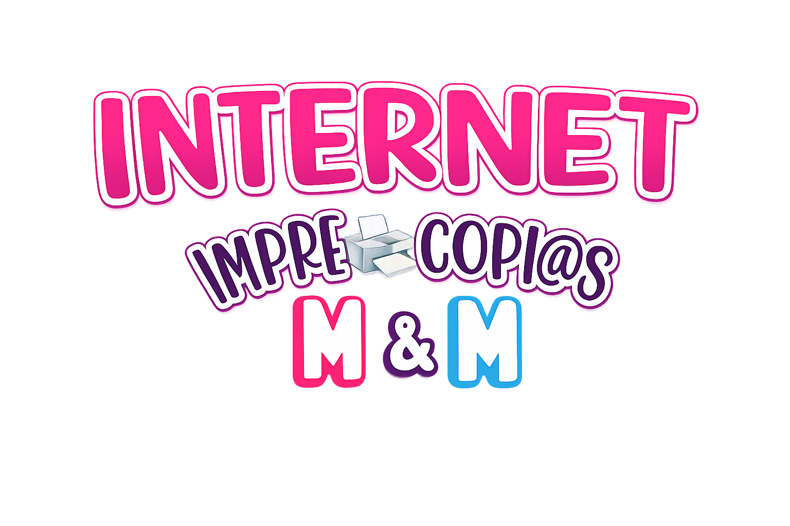
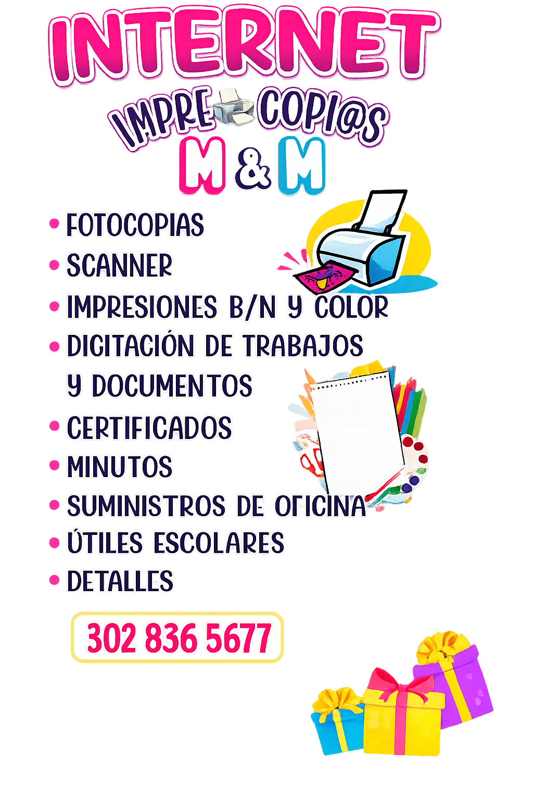

<div align="center">
  
</div>

# Papelería M&M ✏️📒

Bienvenido al código fuente de la Landing Page de **Papelería M&M**, el emprendimiento de mi mami. Un espacio diseñado para mostrar nuestros productos y conectar mejor con el barrio.

---

## Nuestros Servicios

Aquí puedes ver todo lo que ofrecemos a nuestra comunidad. Desde digitalizaciones rápidas hasta útiles escolares:

<div align="center">
  
</div>

---

## ✨ Características

- **Landing page de una sola página** con navegación por scroll-snap: cada 
  sección (Inicio, Nosotros, Servicios, Contacto) ocupa la pantalla completa y se 
  encadena de forma fluida al hacer scroll o al usar el menú de navegación.
- **Animaciones cuidadas** con Framer Motion, React Spring y GSAP: aparición 
  progresiva de textos y tarjetas, efectos hover, y un footer que se revela con 
  fade al llegar al final del recorrido.
- **Carrusel de servicios** con desplazamiento automático infinito, mostrando 
  las 6 líneas de servicio de la papelería.
- **Sección de contacto** enfocada en WhatsApp como canal principal, con horario 
  de atención y sin exponer la ubicación física del negocio.
- **Diseño responsive** adaptado a mobile, con menú de navegación tipo drawer y 
  espaciado ajustado por breakpoint.
- **Identidad visual propia**: paleta rosa fucsia y cian, tipografía redondeada, 
  y fondo de cuadrícula animado que refuerza la idea de "papelería/cuaderno".

---

## 🚀 Tecnologías Utilizadas

Este proyecto está construido con:

<div align="left">
  
  
  
  
</div>

### ¿Por qué Vite + React puro?
Se decidió utilizar **React y Vite** (en lugar de frameworks más pesados como Next.js) porque **es un proyecto pequeño** y esta combinación nos otorga la **máxima flexibilidad** y rapidez. No necesitábamos la complejidad del Server-Side Rendering para una landing page de este tipo; buscábamos un desarrollo ágil, componentes limpios y un empaquetado ultra rápido.

---

## 💻 Desarrollo Local

Si deseas correr este proyecto de manera local, los pasos son muy sencillos (asegúrate de tener `bun` instalado):

1. Clona el repositorio:
   ```bash
   git clone https://github.com/Juandamm01/PapeleriaM-M.git
   ```

2. Instala las dependencias:
   ```bash
   bun install
   ```

3. Inicia el servidor de desarrollo:
   ```bash
   bun run dev
   ```

El proyecto estará corriendo localmente en tu navegador.

## 🔧 Estado del proyecto

El proyecto contiene una landing page en `Frontend/` y una API de pedidos con un
panel administrativo en `Backend/`.

## Administración y API

Configura `Backend/.env` a partir de `Backend/.env.example`, incluyendo las
variables del administrador, JWT y URL del frontend. No compartas ni publiques
el archivo `.env`.

La API y PostgreSQL corren como contenedores en la red de Docker Compose. Desde
PowerShell, inicia ambos servicios con:

```powershell
cd Backend
docker compose up
```

Compose aplica las migraciones y ejecuta el seed del administrador al iniciar la
API; la base de datos no publica el puerto 5432 en Windows. La API queda
disponible en `http://localhost:3000`. En otra terminal, inicia Vite:

```powershell
cd Frontend
bun install
bun run dev
```

El panel está en `/admin/login`. Para cambiar la URL de la API del frontend,
configura `VITE_API_URL` en `Frontend/.env`.

## Pagos con Nequi (Wompi)

El cliente paga desde `/rastreo` cuando el administrador ya fijó el precio del pedido.
Recibe una notificación en su app Nequi, la aprueba y el pedido queda pagado
automáticamente. El monto siempre sale del pedido guardado en la base.

1. Crea la cuenta en Wompi y copia las llaves de **sandbox** en `Backend/.env`
   (`WOMPI_PUBLIC_KEY`, `WOMPI_PRIVATE_KEY`, `WOMPI_INTEGRITY_SECRET`,
   `WOMPI_EVENTS_SECRET`). Nunca las subas a git.
2. En el panel de Wompi configura la URL de eventos:
   `https://<tu-api>/pagos/webhook` (una para sandbox y otra para producción).
3. Prueba en sandbox con estos celulares: `3991111111` (aprobado),
   `3992222222` (rechazado) y cualquier otro (error).
4. Pruebas de las firmas: `cd Backend && bun run test`.

Si las llaves no están configuradas, la página de rastreo indica que el pago en
línea no está disponible y el pedido se paga en el local.
